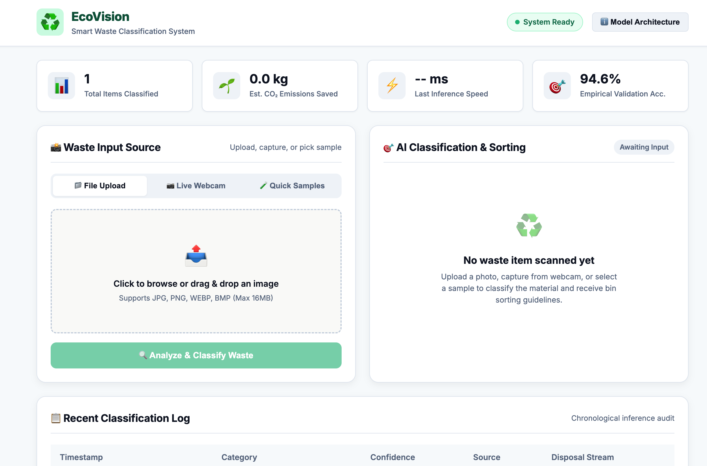
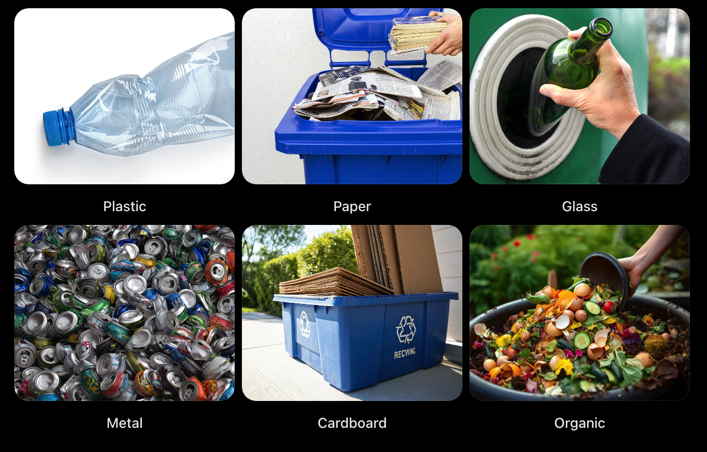
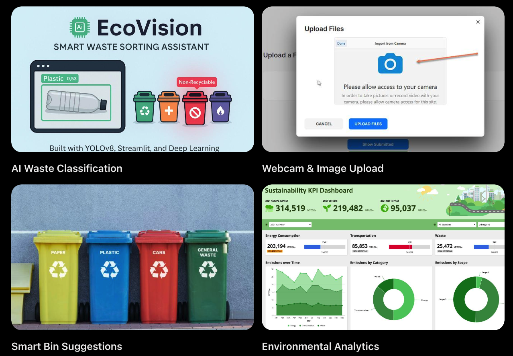

<h1 align="center">♻️ EcoVision</h1>

<p align="center">
   Smart Waste Classification System
</p>

EcoVision is a deep learning-based waste classification and recycling assistant that identifies waste types from images and provides appropriate disposal and recycling recommendations. It aims to promote efficient waste segregation, reduce recycling contamination, and support sustainable waste management.

The project follows the Model--View--Controller (MVC) architecture,
keeping classification logic, request handling, and the user interface
organized into separate layers.

<p align="center">
  
</p>


🌱 Waste Categories
 ## ♻️ Waste Categories

<p align="center">
  
</p>

The application configuration also includes a human category as a
non-waste safety category.

✨ Key Features


- Image Classification: Submit waste images for classification.
- Webcam Capture: Capture an item using your device camera.
- Drag-and-Drop Upload: Upload supported image formats.
- Sample Images: Try the application with sample category images.
- Smart Bin Suggestions: Get a suggested waste-disposal category.
- Confidence Scores: View the class probability distribution.
- Environmental Metrics: View estimated carbon-savings and
  decomposition information.
- Scan History: Review previously scanned items.


## ✨ Key Features

<p align="center">
  
</p>


🛠️ Technology Stack

## 🛠️ Tech Stack


## 🏗️ Project Architecture

```text
EcoVision/
│
├── app.py                 # Flask application entry point
├── config.py              # Application configuration
├── requirements.txt       # Python dependencies
├── run.sh                 # Automated setup and launch
├── Procfile               # Deployment process
├── Dockerfile             # Docker configuration
├── render.yaml            # Render deployment settings
│
├── models/                # Model and classification logic
├── controllers/           # Request handling
├── frontend/              # HTML, CSS and JavaScript
└── datasets/              # Samples and uploaded images
```

## 🔄 MVC Workflow

```text
User
  ↓
Frontend (View)
  ↓
Controller
  ↓
Model / Classifier
  ↓
Classification Result
  ↓
Frontend (View)
```


🚀 Getting Started

Prerequisites
- Python 3.10 or newer
- pip
- Git

1. Clone the repository

git clone <YOUR_REPOSITORY_URL>
cd EcoVision

2. Run the setup script (recommended)
On macOS or Linux:
chmod +x run.sh
./run.sh
The script creates a virtual environment if required, installs
dependencies from requirements.txt, and starts the application.

3. Manual installation
If you prefer to install dependencies yourself:
python3 -m venv venv
source venv/bin/activate
pip install -r requirements.txt
python3 app.py

## 🎥 Project Demo


https://github.com/user-attachments/assets/17de4b62-b9c8-439b-9c7f-ba76d1c41e51


